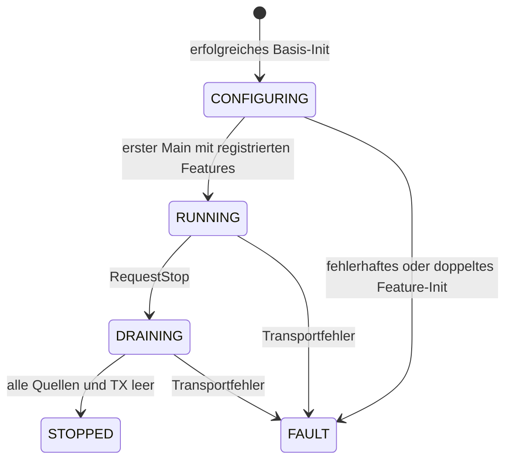

# Endpoint und getrennte Feature-Module

Der optionale Endpoint richtet den gemeinsamen Transport ein und koordiniert
die ausgewählten Features. Die Anwendung ruft nach der Initialisierung nur
`KymoEndpoint_Main()` zyklisch auf. Die Library verwendet C-kompatible Header,
C++11-Implementierungen und statischen, vom Aufrufer bereitgestellten Speicher.
Bestehende Low-Level-APIs funktionieren weiterhin unabhängig davon.

Der direkt ausführbare Einstieg ist das
[Integrationsbeispiel](../examples/integration/README.md), insbesondere
[kymo_app.cpp](../examples/integration/kymo_app.cpp) für die Auswahl der Features.
Im Projekt kapselt `kymo_init.h/.cpp` die gemeinsame Instanz; die Feature-Dateien
heißen unmittelbar `kymo_plot`, `kymo_param`, `kymo_watch`, `kymo_memory` und
`kymo_trace`. Es gibt keine zusätzliche Setup-Header-Schicht.

## Was gehört wohin?

| Library-Header unter `src/endpoint/` | Öffentliche Aufgabe | Benötigter Modulschalter |
|---|---|---|
| [kymo_endpoint.h](../src/endpoint/kymo_endpoint.h) | Basis-Config, Init, Main, RequestStop, Status | ENDPOINT und TX |
| [features/kymo_plot.h](../src/endpoint/features/kymo_plot.h) | Kanäle, Perioden, Sample-Callback, PlotInit | RUNTIME |
| [features/kymo_param.h](../src/endpoint/features/kymo_param.h) | Parametertabelle und ParamInit | PARAMETERS und DECODER |
| [features/kymo_watch.h](../src/endpoint/features/kymo_watch.h) | Speicherbereiche, Reader, Kanalintervall und WatchInit | WATCH und DECODER |
| [features/kymo_memory.h](../src/endpoint/features/kymo_memory.h) | Speicher-Einträge, Reader, Perioden und MemoryInit | MEMORY |
| [features/kymo_trace.h](../src/endpoint/features/kymo_trace.h) | Recorder, Metadaten, Dictionary, TraceInit und Instrumentierung | TRACE |

Schalter heißen jeweils `KYMO_ENABLE_<NAME>`. ENDPOINT und TX sind standardmäßig
aus. XY benötigt zusätzlich X, XYZ auch Z; diese bleiben Einstellungen des
Plot-Features. ISR-, Scheduler- und Flow-Hooks bleiben beim Trace-Feature und
behalten ihre bisherigen Compile-Schalter und Abhängigkeiten.

Jeder Feature-Header enthält nur seine eigene Fassade und seine benötigte
Low-Level-Schnittstelle. Er inkludiert weder andere Feature-Fassaden noch den
Sammelheader `KymoCore.h`. Gemeinsame interne Typen ermöglichen die statische
Speicherbereitstellung; ihre Felder sind keine Erweiterungs-API.

## Initialisieren und betreiben

1. Einheitliche Build-Schalter für **alle** Library- und Anwendungsdateien setzen,
   bevorzugt über `KYMO_USER_CONFIG_HEADER`.
2. Einen nullinitialisierten `KymoEndpoint`, TX-Puffer und gegebenenfalls einen
   separaten RX-Puffer dauerhaft bereitstellen.
3. `KymoEndpointConfig` nach Namen füllen und `KymoEndpoint_Init()` aufrufen.
4. Für jedes gewünschte Feature einen eigenen nullinitialisierten Kontext und
   eine eigene Config bereitstellen; `KymoEndpoint<Feature>_Init()` aufrufen.
5. Jeden Init-Status prüfen. Erst danach `KymoEndpoint_Main()` regelmäßig aufrufen.

Die konkreten Init-Namen sind `KymoEndpointPlot_Init`, `KymoEndpointParam_Init`,
`KymoEndpointWatch_Init`, `KymoEndpointMemory_Init` und `KymoEndpointTrace_Init`.
Jeder Aufruf initialisiert und registriert sein Feature vollständig. Weder
separate Registrierung noch manuelles Feed/NextSample/Mux-Service sind nötig.
Initialisierung verursacht keine physischen Port-Aufrufe.

Ein Projekt kann die Instanzen so wie das Beispiel in eigenen CPP-Dateien
kapseln. Dort lauten die Aufrufe `KymoApp_Init`, `KymoApp_PlotInit` usw. und
`KymoApp_Main`. Diese Namen sind Projektfunktionen; die Library kennt keine
globale Singleton-Instanz. Mehrere unabhängige Endpoints sind möglich.

Die Basis-Config umfasst ausschließlich Transport und Uhr:

- `tx`: Puffer, Kapazität, nichtblockierendes `write`, optionales `busy` und Kontext.
- `read`: nichtblockierendes Lesen, für Param/Watch erforderlich.
- `rx_buffer`/`rx_capacity`: getrennte RX-Ablage und maximales RX-Budget pro Main.
- `service`: optionaler begrenzter Port-Service; wird vom Endpoint aufgerufen.
- `clock_ms`/`clock_user`: Uhr für Plot, Watch und Memory.

`read` und `service` erhalten `tx.transport_user`. Der Trace-Recorder erhält
seine eigene Tick-Uhr mit passender Frequenz in den Metadaten. Callbacks müssen
innerhalb der eigenen Echtzeitgrenzen zurückkehren; der Endpoint kann einen
blockierenden Callback nicht unterbrechen.

Für Plot-Kanäle, die nur `float`-Variablen senden, kann `Kymo_SampleBound`
mit einem `KymoPlotBinding` als `sample` und `sample_user` der
`KymoEndpointPlotConfig` dienen. Es sind dieselben Tabellen wie bei
`Kymo_Init`; ein eigener Sample-Callback entfällt.

## Speicher, Kanäle und Zustände

Der Endpoint speichert Referenzen auf die registrierten Feature-Kontexte. Ein
Feature besitzt seine eigenen Zustände. Configs werden kopiert; referenzierte
Tabellen, Adressbereiche, Metadaten, Puffer und Callback-Kontexte müssen gültig
bleiben. Kontext und Puffer dürfen nach Init nicht verschoben oder kopiert werden.
Gebundene Low-Level-Zustände werden anschließend ausschließlich vom Endpoint
bedient; direkte parallele Main/Feed/Service-Aufrufe sind nicht erlaubt.

Der TX-Puffer muss mindestens den größten Frame aller gewählten Features
aufnehmen. Die Grenzen werden bei Feature-Init geprüft:

| Feature | Mindestkapazität |
|---|---|
| Plot | `KYMO_FRAME_MAX_SIZE` |
| Param | `KYMO_PARAM_FRAME_MAX_SIZE` |
| Watch | `KYMO_WATCH_FRAME_MAX_SIZE` |
| Memory | `KYMO_MEMORY_FRAME_MAX_SIZE` |
| Trace | `KYMO_TRACE_FRAME_MAX` |

Die Konstanten kommen aus den jeweiligen Feature-Headern. Das Vollbeispiel
verwendet 240 Bytes. Zusätzlich fallen die Feature-Zustände, Endpoint-Verwaltung
und temporäre Encoder-Puffer an. Unbenutzte Features benötigen keine Instanz;
Compile-Schalter entfernen ihre Implementierungen vollständig.

Plot-IDs, Parameter-IDs und Memory-Kanäle werden reserviert. Watch reserviert
sein vollständiges inklusives Intervall `first_channel..last_channel`.
Überschneidungen scheitern unabhängig von der Init-Reihenfolge. Host-Anfragen
außerhalb des Watch-Intervalls erhalten `KYMO_WATCH_STATUS_OUT_OF_RANGE`.
Einzelne Feature-Instanzen pro Typ und Endpoint sind vorgesehen.

Spätes Feature-Init liefert `KYMO_REJECTED`, ohne den laufenden Endpoint zu
verändern. Wiederholtes Basis-Init wird ebenfalls abgelehnt. Ein Fehler beim
ersten Basis-Init lässt den uninitialisierten Kontext korrigierbar; ein Fehler
beim registrierenden Feature-Init verriegelt den Start. Es gibt keinen impliziten
Reset/Reconnect. Für einen neuen Objektlebenszyklus müssen Produzenten und
Treiber beendet sein und alle ausgeliehenen Puffer freigegeben werden.

## Verarbeitung und Fehler

Main bedient einmal den optionalen Port-Service, liest einmal bis zum RX-Budget
und verteilt dieselben Bytes an Param/Watch. Danach bedient `KymoTx` den Versand
mit höchstens einem Schreibversuch. Erst bei freiem Sender bearbeitet der
Endpoint eine Quelle. Quellen rotieren in stabiler Reihenfolge: Plot,
Param-Rücklesewert/-Beschreibung, Watch-Antwort/-Sample, Memory-Info/-Sample,
Trace. Die Init-Reihenfolge verändert diesen Ablauf nicht.

Eine vollständige Frame-Kopie geht an `KymoTx`. Dadurch dürfen die Module ihre
eigenen Encoder-Puffer wiederverwenden. Teilübertragungen, Rückstau und
ausgeliehene DMA-Bytes bleiben allein beim vorhandenen Sender. Null-Annahme ist
normal. Die Rückgabe `write > angebotene Länge` oder `read > RX-Kapazität` erzeugt
einen dauerhaften `KYMO_IO_ERROR`. Ein Callback darf niemals tatsächlich über
seine Puffergrenze schreiben; eine nachträgliche Größenprüfung verhindert keinen
bereits erfolgten Speicherüberlauf.

| Main-Status | Bedeutung |
|---|---|
| `KYMO_BUSY` | TX oder Abschluss benötigt weitere Aufrufe |
| `KYMO_OK` | Arbeit erledigt |
| `KYMO_IDLE` | Aktuell keine Arbeit; nach Stop vollständig beendet |
| `KYMO_BAD_SAMPLE` | Ungültiger Messwert verworfen; andere Quellen laufen weiter |
| Konfigurations-/Transportfehler | Terminal; `error` und `error_feature` liefern Diagnose |

Die Arbeit pro Aufruf ist begrenzt, aber keine Bandbreitenzusage. Rückstau
verzögert Messungen. Trace-Ringe können überlaufen; ihre Verlustzähler bleiben
relevant. Es gibt weder Nachladen von Features noch Heap oder Hintergrundtasks.

## Trace und geordneter Abschluss

Der Trace-Adapter sendet Session-Metadaten und Dictionary vollständig vor seinen
Ereignissen. Früh erfasste Ereignisse warten im Recorder. Die Config verlangt
beide persistenten Datensätze, eine Session-ID und Generation ungleich null.
Inhalte, Dictionary-Hash, Symbol-IDs und Zeitbasis müssen zueinander passen;
Init prüft Ressourcen und Größen, kein JSON-Schema.

`KYMO_ENDPOINT_TRACE_ENTER`, `EXIT`, `MARK`, `SCOPE`, `ISR_ENTER`, `ISR_EXIT`,
`SCHEDULER`, `FLOW_SEND` und `FLOW_RECEIVE` gehören zum Trace-Header und erhalten
den Feature-Zeiger als erstes Argument. Deaktivierte Makros werten ihre Argumente
nicht aus. Die Library setzt selbst keine Hooks in Anwendungsfunktionen ein.

Standardmodell ist ein serialisierter Aufrufer. Auch Trace-Fassaden lesen den
Endpoint-Zustand und müssen gegenüber Main/Stop extern serialisiert werden.
Recorder-Locks allein synchronisieren den Endpoint nicht. Hardware-/RTOS-/ISR-
Anbindungen müssen diese Vorgabe erfüllen; Init/Main selbst sind nicht ISR-sicher.

Vor `KymoEndpoint_RequestStop()` externe Trace-Produzenten anhalten. Danach
denselben Main-Aufruf fortsetzen: kein neues RX/Sampling, keine periodischen
Memory-/Health-Nachrichten, aber bestehende Antworten, Trace und Session-End
werden beendet. `KYMO_IDLE` bestätigt den abgeschlossenen Stop einschließlich
der letzten physischen Pufferfreigabe. Ein dauerhaft beschäftigter Treiber kann
den Abschluss verzögern; es gibt keine unsichere Freigabe per Timeout.

## Prüfungen und Werkzeugstand

`python test/native_test.py` prüft Einzelmodule und Kombinationen, echte C99-
Aufrufer, Header-Trennung, Compile-out, Init-Fehler, Kanalbelegung, Rückstau,
DMA-Simulation und das vollständige Integrationsbeispiel. Der Beispiel-Runner
kann zusätzlich KymoStudio gegen die erzeugten Captures ausführen.

Der Konfigurator-Build-Audit erkennt widersprüchliche Endpoint-Schalter.
Konfigurator-UI und Generator erzeugen weiterhin die bisherige Low-Level-
Integration; Endpoint-Code wird nach diesem Beispiel eingerichtet.

### Optional Trace metadata repetition

Set `KymoEndpointTraceConfig.metadata_period_ticks` to a recorder-clock interval
(e.g. 5,000,000 ticks for five seconds with a 1 MHz clock). Zero, the default,
sends session metadata and the dictionary only at startup. The interval starts
when the previous pair has been handed to the shared transmitter. Data is sent
in bounded fragments with backpressure; no periodic copies are accumulated.
Readiness stays true after startup during later refreshes. Normal trace servicing
gets a turn between refreshes. Stop finishes an active pair and drains events and
session end, without scheduling another refresh. This can consume link bandwidth
and delay events while metadata is transferred; size buffers/rates accordingly.
A KymoStudio connection request is not part of this release.

With `KYMO_ENABLE_TIMESTAMP=1`, Param readbacks, Watch samples and Memory samples
carry the Endpoint cycle's millisecond clock. This preserves device sample time
under transport backpressure. Plot keeps its per-channel timestamp flags.

All Endpoint DATA timestamps, including Plot, use the same clock_ms origin.
Plot is not rebased to its feature initialization; standalone Kymo_Init retains
its initialization-relative timestamps.
